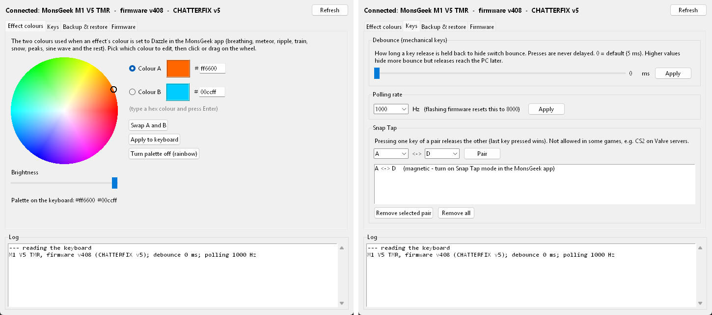

# MonsGeek M1 V5 TMR: fix for double key presses with mechanical switches

An **unofficial** firmware patch for the **MonsGeek M1 V5 TMR** (device ID 2949) when it is fitted with ordinary **mechanical (contact) switches** instead of TMR magnetic switches.

**The symptom:** single key presses sometimes register twice. The second press arrives 15–27 ms after the first release. The driver's debounce setting has no effect on it.

> ⚠️ Unofficial and at your own risk. Tested on one keyboard (Windows 11, USB cable). It flashes the keyboard's main firmware. Recovery steps are in the [guide](docs/HOW_TO_FLASH.md#5-if-something-goes-wrong). Going back to stock only needs the public V408 file and `flash_fw.py`; MonsGeek's `ry_upgrade.exe` is not required.

## Install

1. Download `firmware_v5.bin` from **[Releases](../../releases)** and this repository (**Code → Download ZIP**). Put the `.bin` in the `tools` folder.
2. Install Python 3 and run `pip install hidapi`.
3. Flash it, either way:
   - **With the app:** double-click `tools\MonsGeek Companion.bat`, open the **Firmware** tab and press **Flash...**. It backs up your settings first and restores them afterwards. See [docs/COMPANION_APP.md](docs/COMPANION_APP.md).
   - **From the command line:** follow [docs/HOW_TO_FLASH.md](docs/HOW_TO_FLASH.md):
     ```
     python flash_fw.py firmware_v5.bin          (dry run: must show "device id 2949")
     python flash_fw.py firmware_v5.bin --yes
     python polling.py 1000
     ```
4. Your mechanical keys must be **switch type 7** (MonsGeek's mechanical type). `python backup_full.py` shows the switch types.

Flashing resets lighting, macros, Snap Tap and polling rate. The app's automatic backup/restore puts them back; on the command line, run `backup_full.py` first.

## Companion app



`tools/companion.py` is a small Windows app to use alongside MonsGeek's driver. It covers:
- **Effect colours:** a colour wheel for the two dazzle colours;
- **Keys:** the debounce time, polling rate and Snap Tap pairs;
- **Backup & restore:** settings backups, with a preview of what a restore would change;
- **Firmware:** a flasher that keeps your settings.

How it works: [docs/COMPANION_APP.md](docs/COMPANION_APP.md).

## Why it happens

- **No debounce:** V408 sends a release the moment a contact switch flickers open. The driver's debounce slider is stored but never used.
- **A lockout that makes it worse:** MonsGeek's mechanical-switch fix (V407/V408, switch type 7) then blocks the key from registering again until a counter has advanced 4 times. That counter only advances every 5 ms, so the result is a release followed by a press **15–20 ms later**: a double press.
- **Bounce is normal:** healthy switches bounce for under 1.5 ms at every press and release. Without debounce, any bounce can trigger this.

The full analysis with firmware addresses is in [docs/REPORT_1_double_presses.md](docs/REPORT_1_double_presses.md).

## What the patched firmware changes

Everything else is stock V408.

| Change | Effect |
|---|---|
| The type-7 lockout is removed | Re-presses are no longer delayed 15–20 ms |
| A 5 ms release debounce for mechanical keys (type 7) | Presses are sent instantly; releases wait 5 ms, and bounces under 5 ms are ignored |
| The driver's **debounce slider** now works | 1–50 ms sets the release debounce on mechanical keys (0 = 5 ms) |
| **Snap Tap** for mechanical keys | `python snaptap.py A D`: pressing one key releases the other. Clear it with `snaptap.py clear all` where it isn't allowed, e.g. CS2 on Valve's servers |
| Macro read-back fixed | Macros can be backed up (`backup_full.py`) and restored (`restore_settings.py`) |
| Range checks on settings commands, and a check on saved settings at boot | Bad or corrupted values can no longer corrupt memory or put the keyboard in a crash loop |
| **Two-colour dazzle** (v5) | Pick two colours (app or `palette.py`) and the dazzle option uses them. Breathing fades A → B → A; meteors, ripples, trains, snowflakes and peaks each get one colour, alternating; ripples fade with distance and blend where they cross; the sine wave gets a moving A → B band. See [the app docs](docs/COMPANION_APP.md#effect-colours) |

Details are in [docs/REPORT_2_more_bugs.md](docs/REPORT_2_more_bugs.md).

TMR (magnetic) keys and the rotary knob keep stock behaviour.

**Results on the test keyboard:**

| Firmware | Double presses |
|---|---|
| Stock V408 | 1.1–1.3 % of presses |
| Patched, normal typing | 0 in 1,015 presses |

## Building it yourself

The release binary can be reproduced exactly from public files:

1. Put stock V408 in `patch/` as `firmware_v408.bin`. Use `firmwares/2949-v408/firmware_2949_v408.bin` from [monsgeek-akko-linux](https://github.com/echtzeit-solutions/monsgeek-akko-linux). The patcher checks its hash.
2. Install an `arm-none-eabi` GCC toolchain (tested: 10.3-2021.10) and Python 3. On Windows, use WSL.
3. Run:
   ```
   cd patch
   CHATTER_PALETTE=1 CHATTER_V4=1 CHATTER_MACROFIX=1 CHATTER_NOGATE=1 CHATTER_HOLD_MS=5 CHATTER_OUT=firmware_v5.bin bash build.sh
   sha256sum firmware_v5.bin
   ```
   The hash should match the release. Leave out `CHATTER_PALETTE=1` to build v4.

**Tests:** `patch/test/` compiles the real patch code on a PC and runs it against scripted key events and vendor commands.
- **v4 tests:**
  1. Build the harness in WSL:
     ```
     gcc -O1 -I . -DHOLD_MS=5 -DCHATTER_V4 -o /tmp/chatterfix_harness test/harness.c
     ```
  2. On Windows, run `HOLD_MS=5 python test/v4_test.py` and `python test/logic_test.py`.
- **v5 palette and effect tests:** build the harness with `-DCHATTER_PALETTE` added, then run `python test/palette_test.py`.

## Tools (`tools/`)

| Script | What it does |
|---|---|
| `flash_fw.py` | Paced USB flasher: checks the model, verifies the bootloader's checksum verdict, retries automatically |
| `chatter_test.py` | Measures double presses while you type (Windows) |
| `polling.py`, `debounce.py` | Read or set the polling rate and the debounce |
| `snaptap.py` | Set or clear Snap Tap pairs |
| `backup_full.py`, `restore_settings.py` | Back up and restore settings over USB, including macros, Snap Tap and the palette |
| `palette.py` | Set the two dazzle colours (`python palette.py ff6600 00ccff`, or `off`) |
| `effect_tour.py` | Show each lighting mode's number, or print the current one (`--now`) |
| `companion.py` | The companion app (start it with `MonsGeek Companion.bat`) |

## Credits

- The reverse-engineering groundwork, the protocol documentation and the public V408 image come from **[monsgeek-akko-linux](https://github.com/echtzeit-solutions/monsgeek-akko-linux)**. Several of the bugs in report 2 were first described there.
- This patch is not affiliated with or endorsed by MonsGeek. "MonsGeek" is their trademark. The findings were reported to MonsGeek support.

## License

The patch code, tools and documentation are MIT licensed (see [LICENSE](LICENSE)). MonsGeek's firmware is not included in the source; the release binary is V408 with this patch applied.
