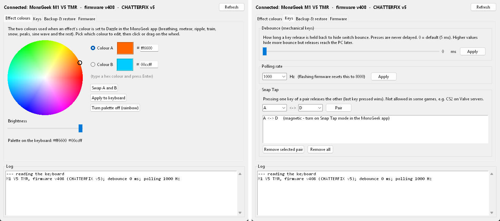

# MonsGeek Companion app

A small Windows app that sits next to MonsGeek's own driver. It handles the things the patched firmware adds, or that MonsGeek's driver can't do:
- custom dazzle colours;
- the debounce time;
- Snap Tap on mechanical keys;
- settings backup and restore;
- firmware flashing.



## Install and start

1. Install **Python 3** from python.org. Tick "Add Python to PATH".
2. Open a Command Prompt and run:
   ```
   pip install hidapi
   ```
3. Download this repository (**Code → Download ZIP**) and unzip it.
4. Put `firmware_v5.bin` from the **Releases** page into the `tools` folder, if you want to flash from the app.
5. Double-click **`tools\MonsGeek Companion.bat`**. You can also run `python companion.py` from the `tools` folder to see error messages.

The keyboard must be connected **by USB cable**. You can leave MonsGeek's driver open, but don't change settings in both at the same moment.

At the top the app shows what it found, for example `Connected: MonsGeek M1 V5 TMR - firmware v408 - CHATTERFIX v5`. Press **Refresh** after plugging the keyboard in or changing things in MonsGeek's app.

## Tabs

### Effect colours
- Pick **Colour A** or **Colour B**, then click or drag on the wheel. Or type a hex colour such as `ff6600` and press Enter. **Brightness** sets how dark the colour is.
- **Apply to keyboard** saves the two colours on the keyboard.
- **Turn palette off** returns to MonsGeek's rainbow.

The colours are used whenever an effect's colour is set to **Dazzle** in MonsGeek's app:

| Effect (MonsGeek app name) | With a palette |
|---|---|
| Dynamic breathing | Each breath starts as A, turns into B at full brightness, and fades back to A |
| Meteor | Each meteor is one colour, alternating A and B. The trail fades in the same colour |
| Waves ripple | Each keypress ripple is one colour, alternating, and fades with distance. Where ripples cross, the colours blend and the key lights up again |
| Train | One train is A, the other B |
| Snow | Each flake keeps one colour all the way down, alternating |
| Peaks rising one after another | One peak is A, the other B |
| Sine wave | A smooth A → B → A band that travels with the wave |
| All other effects | Their rainbow colours are mapped onto the A → B range |

These need the CHATTERFIX **v5** firmware. On older firmware the tab says so.

### Keys
- **Debounce (mechanical keys):** how long a key release is held back to hide switch bounce. Presses are never delayed. `0` means the default of 5 ms. If you still see double letters while typing normally, try 8–10 ms.
- **Polling rate:** flashing resets it to 8000 Hz, so set it back here (1000 Hz is a good default).
- **Snap Tap:**
  - Choose two keys and press **Pair**. While both are held, the one pressed last wins: holding A then pressing D releases A.
  - For **magnetic** keys, also turn on Snap Tap mode for those keys in MonsGeek's app; the list reminds you.
  - Some games forbid Snap Tap, e.g. CS2 on Valve servers, so use **Remove all** there.

### Backup & restore
- **Back up now** saves almost everything to a `full_backup_<date>.json` file in the `tools` folder:
  - lighting, key bindings for all profiles and layers, macros and Fn layers;
  - Snap Tap pairs, the dazzle palette and the magnetic switch settings.
- **Show what would change** compares a backup with the keyboard and lists the differences without writing anything.
- **Restore selected backup** writes back what differs: lighting, key bindings, macros, Snap Tap and the palette. Switch types are never changed.

Check the date before restoring. The list shows each backup's lighting mode and palette to help you pick the right one.

### Firmware
- **Browse** to a firmware image, or keep the default `firmware_v5.bin`.
- **Check image and keyboard** does a dry run. It shows the image checksum and confirms the keyboard is an M1 V5 TMR (device id 2949), and flashes nothing.
- **Flash...** asks for confirmation, then:
  1. backs up your settings (if ticked);
  2. flashes, which takes about 30 s;
  3. sets polling back to 1000 Hz (if ticked);
  4. restores your settings and checks the result.

  Don't unplug the keyboard while it runs.
- To go back to MonsGeek's stock firmware, pick [`firmware_2949_v408.bin`](https://github.com/echtzeit-solutions/monsgeek-akko-linux/raw/master/firmwares/2949-v408/firmware_2949_v408.bin).

If a flash fails, the keyboard waits safely in update mode. Press **Flash...** again.

## How it works

The app is a thin layer over the command-line tools in `tools/`. Each tool also works on its own:

| App part | Tool / protocol |
|---|---|
| Status line | `0x8F` version query; `0xEE` (palette read) detects v5 |
| Effect colours | `palette.py`: vendor command `0xEE`, stored in spare space in the keyboard's saved settings |
| Debounce | `debounce.py`: MonsGeek's own `SET_DEBOUNCE` (`0x06`), which CHATTERFIX makes work |
| Polling rate | `polling.py`: `0x03` / `0x83` |
| Snap Tap | `snaptap.py`: MonsGeek's per-key Snap Tap partner table (`0x65` / `0xE5`, sub 9) |
| Backup / restore | `backup_full.py`, `restore_settings.py`: MonsGeek's read/write commands for lighting, key matrix, macros and so on |
| Firmware | `flash_fw.py`: the same USB update protocol as MonsGeek's `ry_upgrade.exe`, paced so the bootloader doesn't drop data |

All keyboard communication goes through the keyboard's USB configuration interface (the one MonsGeek's driver uses), via `hidapi`. Long tasks run in the background, one at a time, and their output appears in the **Log** pane.
